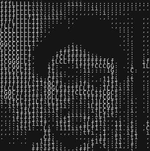
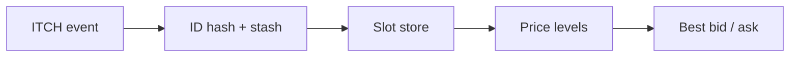
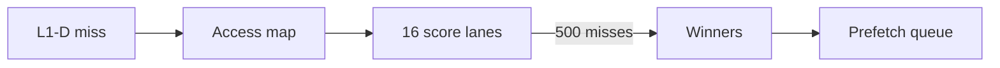

<h1 align="center">Ronit Sonawane</h1>

<strong>FPGA datapaths · memory systems · C++ search · real-time software</strong>

<table>
<tr>
<td width="42%" align="center" valign="middle"></td>
<td width="58%" valign="middle">
<h3>Engineering at the hardware–software boundary</h3>

I build systems where data changes form: network packets into order-book state, cache misses into prefetch decisions, vectors into searchable storage, and events into live interfaces.

<strong>Current work</strong> FPGA order books · cache prefetching · C++ vector search

</td>
</tr>
</table>

## Selected engineering work

### 01 / FPGA limit order book

Source repository is private; public link forthcoming. 
  

**Architecture.** On a Nexys A7-100T, a Verilog-2001 pipeline receives RMII Ethernet frames, validates IPv4/UDP and MoldUDP64/ITCH messages, and crosses into the book core through an asynchronous event FIFO. An RV32IM supervisor and UART telemetry expose control and book state.

**Book mechanics.** Full 64-bit order IDs resolve through a set-associative hash table with a collision stash. A free list allocates slots; slot and price-level memories apply Add, Execute, Cancel, Delete, and Replace events. The best-bid/offer path maintains top prices and quantities. Feed gaps or malformed messages invalidate the book until reset and full replay. Exchange-provided executions update the book; order matching happens upstream.

**Evidence.** Physical-board checks covered Ethernet ingest, book updates, fail-stop behavior, and reset/replay. UART captures also verified bid/ask price, quantity, active-order count, and selected checksum-error counters.

---

### 02 / Multi-Lookahead Offset Prefetching in gem5

Paper implementation · source repository is private; public link forthcoming. 
 

**Architecture.** I implemented a new L1 data-cache prefetcher in gem5, based on Shakerinava et al.'s *Multi-Lookahead Offset Prefetching*. It trains on eligible L1-D misses, not on every memory access or clock cycle.

**Algorithm.** A 256-entry access-map table tracks recent history within 64-block regions. Candidate offsets are scored separately at 16 lookahead levels; every 500 eligible misses, the prefetcher selects winners for those levels. Future misses generate page-safe requests in lookahead order, with duplicate candidates suppressed before queue insertion.

**Evidence.** The gem5 build and all comparison runs completed for sequential, backward, and mixed synthetic streams against no prefetcher and BOP. This evaluation checks integration and behavior on those patterns; broader DPC3-scale validation remains future work.

---

### 03 / [VectorDB](https://github.com/VectorDB-wakawaka/VectorDB)

 

**Public baseline.** In this C++20 collaboration, I contributed a growable, disk-backed memory-mapped arena, the library/test architecture, and sanitizer CI. The current mainline loads `.fvecs`/`.ivecs` datasets and performs exact kNN using squared L2 distance and a bounded top-k heap; an exportable CMake target makes it usable from another C++ project.

**Current research branch.** Work in progress explores capacity-constrained hierarchical clustering, posting-list balance, overlap for boundary vectors, and a dynamic delta chosen from a storage-bloat budget. This experimental index is separate from the exact-search mainline.

**Evidence.** Catch2 includes a SIFT-small integration check that recovers the full ground-truth top 100 with exact search, alongside storage and search unit tests. The research branch is still under evaluation.

---

### 04 / [Coding Club IITG · multiplayer contests](https://github.com/Coding-Club-IITG/CCW)

  

**Architecture.** I contribute to CCW's competitive-programming platform: live Blitz and Arena rooms, 1v1 and tournament formats, participant state, and Codeforces synchronization. MongoDB holds persistent contest entities; Redis coordinates runtime state and publishes events; Server-Sent Events update connected clients.

**My merged work.** Contest UI and permissions, SDK integration, SSE delivery fixes, and persistent forfeit timers. A disconnected player can return to a room without resetting the timer, while room activity stays visible to participants.

**Evidence.** These features are represented by merged changes in the public CCW repository. The platform is a Coding Club IITG team project.

---

### 05 / [HABit IITG](https://github.com/Coding-Club-IITG/iitgHABapp)

  

**Product.** Coding Club IITG and the Hostel Affairs Board built HABit for campus hostel workflows. With the Coding Club team, I worked on the HAB dashboard and its hostel-management views.

**Logging path.** I built work around a Redis-backed application-log queue and a worker that batches log records into PostgreSQL. My merged worker fix sanitizes malformed log content before parsing and keeps a failed flush from crashing the worker process.

**Evidence.** The public repository contains the dashboard's boarder, mess, SMC/HMC, cleaning, and laundry views, plus the Redis-to-PostgreSQL logging worker.

---

## Selected upstream contributions

- **pandas** — corrected pivot-table margin behavior in [PR #66234](https://github.com/pandas-dev/pandas/pull/66234).
- **Astro** — exported the `AstroComponentLogger` type in [PR #17313](https://github.com/withastro/astro/pull/17313).
- **CPH** — improved case-insensitive file-extension and language detection in [PR #687](https://github.com/agrawal-d/cph/pull/687).

All three changes were merged upstream.
